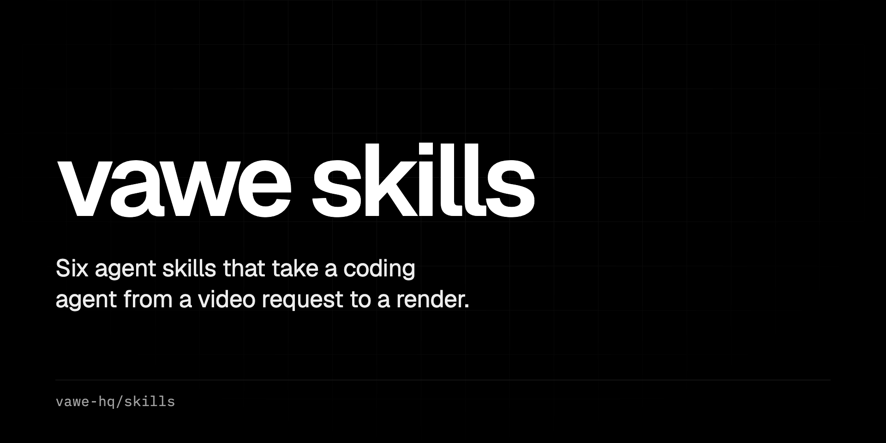

<p align="center">
  <a href="https://vawe.dev"></a>
</p>

<p align="center">
  <a href="https://github.com/vawe-hq/skills/blob/main/LICENSE"></a>
  <a href="https://github.com/vawe-hq/skills/stargazers"></a>
  <a href="https://github.com/vawe-hq/skills/commits/main"></a>
</p>

<p align="center"><b>Agent skills that take a coding agent from a film request to a rendered mp4.</b></p>

<p align="center">
  <a href="https://vawe.dev">vawe.dev</a> |
  <a href="https://vawe.dev/docs">Docs</a> |
  <a href="https://github.com/vawe-hq/vawe">vawe</a>
</p>

# vawe skills

Six agent skills for [vawe](https://github.com/vawe-hq/vawe), the open-source framework that renders
one HTML page to an mp4. They take a coding agent from a film request to a brief, a page, a critique
and a re-render.

| Skill | Use it when |
|---|---|
| `html-to-video` | you want a video and no film exists yet; start here |
| `vawe-brief` | you turn a request into a brief with the facts a film needs |
| `vawe-page` | you write or edit the film's `page.html` |
| `vawe-transitions` | you plan what carries over at each cut |
| `vawe-critique` | you review a rendered film in a fresh session |
| `vawe-reference` | you match a reference film line by line |

## Install

Any agent the `skills` CLI supports:

```bash
npx skills add vawe-hq/skills
```

Claude Code, as a plugin:

```bash
claude plugin marketplace add vawe-hq/skills
claude plugin install vawe@vawe-skills
```

The skills run inside a vawe checkout. Get one with:

```bash
git clone https://github.com/vawe-hq/vawe.git && cd vawe && npm install && bin/vawe doctor
```

## Where to change them

This repository is a copy. The skills live in
[vawe-hq/vawe/skills](https://github.com/vawe-hq/vawe/tree/main/skills), and a workflow copies them
here on each change. Open issues and pull requests there.

Apache-2.0. Docs: [vawe.dev/docs](https://vawe.dev/docs).
