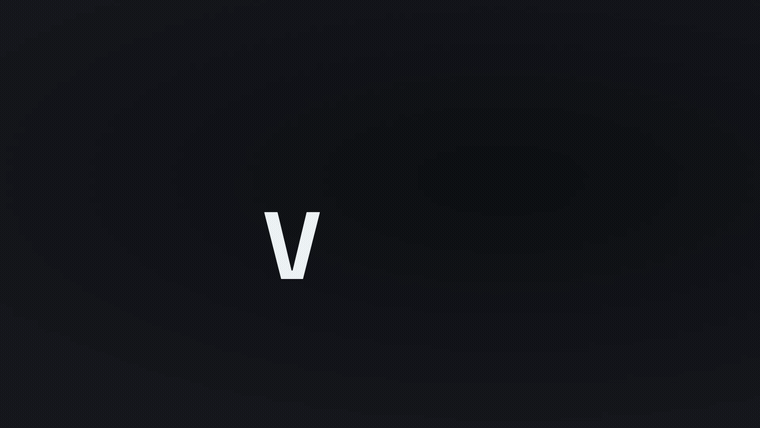
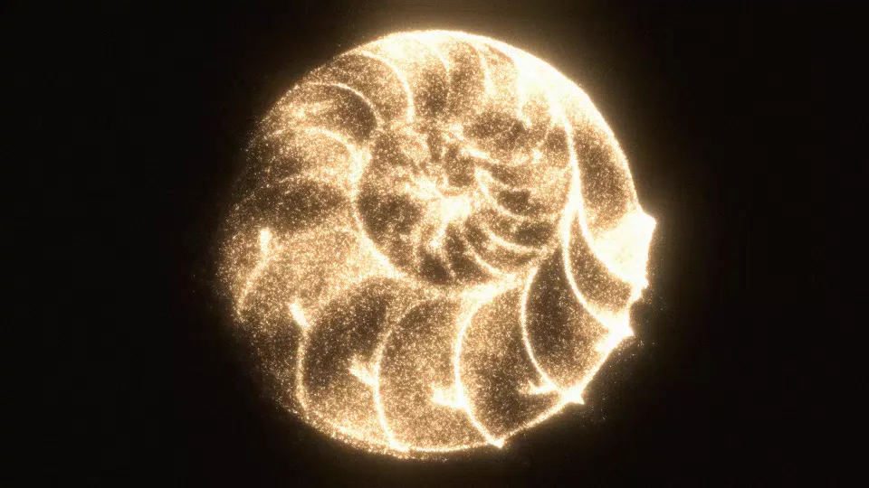
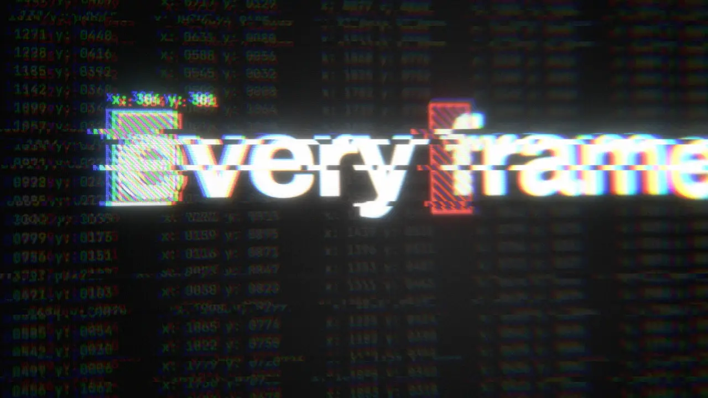
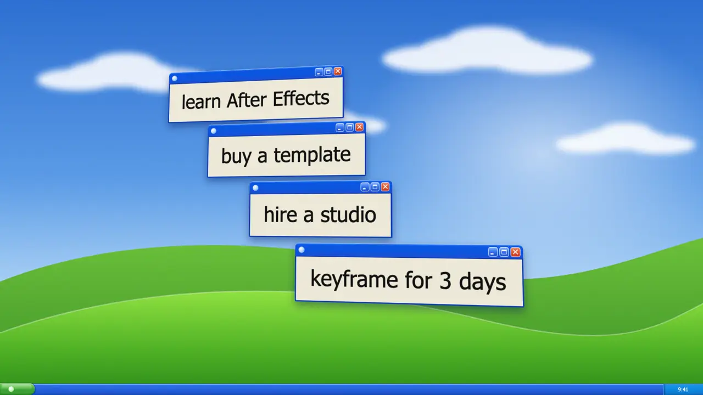

# vawe: HTML to video for coding agents

vawe is an open-source HTML to video framework for agent-native motion graphics: one HTML page in, one
film out. It is programmatic video and motion graphics as code, a free alternative to Remotion,
HyperFrames and Motion Canvas, built so that coding agents (Claude Code, Codex, Cursor) write the films.
The page is plain HTML, CSS, Web Animations, SVG, canvas or three.js. The renderer seeks it frame by
frame in Chrome, mixes its `<audio>` tags offline and encodes one deterministic mp4.

Site and docs: [vawe.dev](https://vawe.dev). For an AI agent: [vawe.dev/ai-agents](https://vawe.dev/ai-agents)
or [llms.txt](https://vawe.dev/llms.txt).



## Quickstart

```bash
git clone https://github.com/Vandit1604/vawe.git && cd vawe
npm install                                  # Node 22+; ffmpeg must be on PATH
npx puppeteer browsers install chrome        # bin/vawe doctor prints this and every other missing tool
bin/vawe new hello --request "a 10 s sting for a coffee brand"
# then run the next: line that each command prints (AGENTS.md is the map)
```

## Films made with vawe

Each film is one `page.html`. Click a still to play the mp4.

| | |
|---|---|
| [](https://vawe.dev/examples/showcase.mp4) | [](https://vawe.dev/examples/cindre.mp4) |
| **showcase**, 14 s: one page rendered to 16:9, 9:16, 1:1, 4:5 and 4:3 | **CINDRE**, 10 s: a perfume film, one page |
| [](https://vawe.dev/examples/tracking-hud.mp4) | [](https://vawe.dev/examples/retro-remix.mp4) |
| **tracking HUD**: a screen filmed through the lens shader (`films/examples/tracking-hud/`) | **retro remix**: a desktop-window style remix |

More: over 120 moves to copy, each with a clip, at [vawe.dev/moves](https://vawe.dev/moves) and in
`prompts/moves/README.md`.

## How it works

### A film is one HTML page

```html
<!doctype html>
<meta name="duration" content="6">
<meta name="message" content="one page, one film">
<style>
  body { margin: 0; background: #0b0d12; color: #f4f6fb; font: 700 calc(var(--vh) * 0.08) system-ui; }
  h1 { position: absolute; left: 8%; top: 40%; animation: rise 0.6s var(--ease-land) both 0.4s; }
  @keyframes rise { from { transform: translateY(40px); opacity: 0 } to { transform: none; opacity: 1 } }
</style>
<h1>one page, one film</h1>
<audio data-synth="chime" data-at="0.4" data-gain="-6"></audio>
```

- `<meta name="duration">` is the length in seconds. Everything else is what you already know.
- Time is the seek. CSS `@keyframes` and `element.animate()` are paused and driven by `currentTime`,
  or define `window.seek(t)` and paint frame t as a pure function of t.
- Before any page script runs, the renderer installs a virtual clock (`Date`, `performance.now`,
  `requestAnimationFrame`, timers and a seeded `Math.random` all follow the seek). It also sets
  `<html data-aspect>`, `--vw`/`--vh` and `window.vawe`, so one page lays out for `16:9 9:16 1:1 4:5 4:3`
  (`bin/vawe ship <page> --aspect all` renders every one).
- The named eases are CSS variables too: `var(--ease-land)` to arrive, `var(--ease-launch)` to exit. The renderer and
  the studio set them; a plain browser does not, so there the page shows its end state with no motion.
- Audio is `<audio>` tags with `data-at`, `data-gain` and `data-fade-out`. `loop` marks a music file the
  user gives. `data-synth` picks a fallback effect voice from `core/audio/kit.mjs` (a recorded effect
  comes first). The mix is offline and as written; `<meta name="loudness">` opts in to a target.
- Springs, keyframe tables and seeded noise: `core/motion/springs.js` (`core/motion/README.md`).

The whole contract, and the mistakes a first draft makes, is `skills/vawe-page/SKILL.md`. In the
example the line rises 40 px as it fades in, holds long enough to read, and the chime lands with the move.

### The loop

```
brief -> reference study -> design and kit -> key frames -> board -> draft -> motion pass
      -> critique in a FRESH session -> fix the named seconds -> owner approval -> final
```

`bin/vawe` is the one command. The core verbs (`bin/vawe --help`; `--help --all` lists every verb):

| verb | does |
|---|---|
| `new` | starts a film: writes `page.html` and `brief.md`, and asks for missing facts first |
| `refs`, `see`, `strip`, `sheet`, `still` | study references and look at a film: shots, motion, light, type, sound |
| `frames` | one still per world, the key state of each beat |
| `storyboard` | an HTML board with a card per world: moves, eases, handoffs, sound, rhythm |
| `dev` | the draft: half size, 30 fps |
| `critique` | phone sheet, strip, loop seam and page checks for a session that did not write the page |
| `approve`, `ship`, `wait` | the owner signs off the draft; the final renders at 60 fps with motion blur and mixed audio |
| `sound`, `check` | voices, beat grid and cues; one named gate (`anim-traps`, `page-check`, `doc-refs`, ...) |

Each verb prints a `next:` line with the next command. The critique rejects by default and names every
finding as shot, frame and fix (`skills/vawe-critique/SKILL.md`). A reference is matched through `SPEC.md`
and a KEEP or CHANGE list (`skills/vawe-reference/SKILL.md`). One prompt template per film type:
`guides/ROUTING.md`.

### Determinism

Every frame is a pure function of its seek time: no wall clock, no state carried between frames, no
unseeded random. That lets the renderer capture frames on several browser pages at once, blur from
fractional subframes, and re-render only the seconds a critique named. `bin/vawe check anim-traps <page>`
finds the seven ways a seeked CSS animation breaks without an error. More: [vawe.dev/determinism](https://vawe.dev/determinism).

## Use it from your agent

- Codex, Cursor and other agents read `AGENTS.md`: setup, the hard rules, the loop and an index of the
  docs. Claude Code reads `CLAUDE.md`, which points to `AGENTS.md`.
- `skills/` holds the skills an agent loads per stage: `html-to-video` (start here), `vawe-brief`,
  `vawe-page`, `vawe-critique`, `vawe-transitions`, `vawe-reference`. Any agent can read a
  `SKILL.md`; nothing to install.
- Ask your agent for a film in plain words. It runs `bin/vawe new <name> --request "<the ask>"` and
  follows the `next:` lines.

## Install

From source: Node 22+, git, ffmpeg (with libx264 and drawtext), and tesseract (optional, for OCR).

```bash
npm install
bin/vawe doctor
bin/vawe dev films/<name>/page.html
```

`bin/vawe doctor` checks each tool and prints the install line for your system (macOS, Linux or Windows)
for each missing one. It exits 1 only when a required tool is missing. A verb that fails because
Chrome is missing prints the same install command. Output can differ between hosts that rasterise on a
different GPU or Chrome version.

## Architecture

```
  films/<name>/page.html            the film: HTML · CSS · WAAPI · seek(t) · <audio> · assets/
          │
          ▼
  harness/media/render-page.mjs     virtual clock (core/engine/page-clock.js) · aspect vars ·
          │                         seek every frame on N browser pages · subframe blur
          ▼
  ffmpeg                            frames -> H.264, one pass
          │
          ▼
  harness/media/page-audio.mjs      <audio> tags -> one offline mix (synth voices: core/audio/kit.mjs)
          │
          ▼
  out/<name>[-<aspect>][-draft].mp4
```

```
core/motion/       springs.js (spring, track, approach, kf, springLinear, rng, noise1), curves.js
core/engine/       page-clock.js (the virtual clock), page-api.js (vawe.onFrame, three.js helpers)
core/audio/        kit.mjs: the synth voices
bin/               vawe: the one command; --help lists the verbs
harness/cli/       the verb table and argument parser behind it
harness/media/     render-page.mjs · page-audio.mjs · see.mjs (the views) · ref-spec.mjs · review.mjs
quality/gates/     page-check.mjs · anim-traps.mjs · judge.mjs · doc-refs.mjs
prompts/           one template per film type, and prompts/moves/ (moves to copy, with clips)
skills/            html-to-video (start here) · vawe-brief · vawe-page · vawe-critique · vawe-reference · vawe-transitions
taste/             rules/ (one rule per file) · craft/ · build/ (generated) · README.md (the index)
guides/            engine and process guides (ROUTING.md picks a film type) · judge.md
films/             <name>/page.html per film; films/examples/ holds the reference films
out/               rendered mp4s (gitignored)
```

## Docs

- [vawe.dev](https://vawe.dev): the site, [features](https://vawe.dev/features), [moves](https://vawe.dev/moves),
  [blog](https://vawe.dev/blog), [Remotion alternatives](https://vawe.dev/remotion-alternatives) and
  [HyperFrames alternatives](https://vawe.dev/hyperframes-alternatives).
- In the repo: `AGENTS.md` (the map), `guides/ROUTING.md` (film types), `prompts/moves/README.md`,
  `core/motion/README.md`, `taste/README.md` (every taste rule; `taste/build/DIGEST.md` is the first
  read) and `guides/judge.md` (how a film is scored).

## FAQ

**What is vawe?** An HTML to video renderer and workflow for motion graphics as code. You, or your
agent, write one HTML page; `bin/vawe ship` turns it into an mp4.

**How is it different from Remotion?** There is no React component tree and no timeline API to learn.
The page uses CSS animations, Web Animations or a `window.seek(t)` function, and the renderer drives
them by seek time. Comparisons: [vawe.dev/remotion-alternatives](https://vawe.dev/remotion-alternatives).

**Which agents does it work with?** Any agent that reads files and runs shell commands. Claude Code
reads `CLAUDE.md`; Codex, Cursor and others read `AGENTS.md`.

**Is the output deterministic?** Yes. The same page renders the same frames in any frame order,
because a virtual clock replaces `Date`, timers, `requestAnimationFrame` and `Math.random`.

**Which formats and aspect ratios?** H.264 mp4, at 16:9, 9:16, 1:1, 4:5 and 4:3 from one page.

**Can I use GSAP, three.js or canvas?** Yes: anything that paints from the seek time. See
`core/engine/page-api.js` for `vawe.onFrame` and the three.js helpers.

**Is it free for commercial use?** Yes, under the Apache License 2.0.

## Status and license

vawe is under active development and released under the [Apache License 2.0](LICENSE): free to use,
change and distribute for any purpose, including production and commercial use. [LICENSE](LICENSE) has
the full text and the patent grant; [NOTICE](NOTICE) has the third-party attribution. Contributions and issues are welcome (`CONTRIBUTING.md`).
